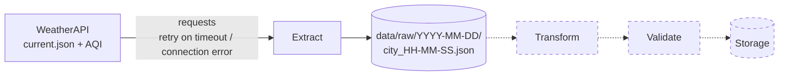

# City Data Pipeline

A data pipeline that collects current **weather and air-quality data for ten Saudi cities** from [WeatherAPI](https://www.weatherapi.com/) and stores every raw API response for later processing.


> **Status: version 0.1, in progress.** The **extract** stage is implemented. Transformation, validation and loading are planned (see [Roadmap](#roadmap)).

## Problem Statement

Weather and air-quality readings change throughout the day, and an API only returns the current value. To analyse trends across cities, the data has to be collected regularly, kept in its original form, and then cleaned and stored in a consistent structure. This project builds that pipeline step by step.

## Objectives

- Collect temperature, humidity, wind speed and air quality (PM2.5, PM10) for Riyadh, Jeddah, Dammam, Makkah, Madinah, Abha, Tabuk, Hail, Jazan and Buraidah.
- Keep the raw responses unchanged, so later stages can be re-run without calling the API again.
- Handle network failures without losing the whole run.
- Keep secrets out of the code and the repository.

## Technologies

| Area | Tools |
|---|---|
| Language | Python 3.12+ |
| HTTP and retries | requests, tenacity |
| Configuration | python-dotenv (`.env`) |
| Environment | uv |
| Code quality | Ruff, Black, mypy, pytest (dev dependencies) |

## Architecture



Solid steps are implemented; dashed steps are planned.

### Extract stage (implemented)

[`pipeline/extract.py`](src/city_data_pipeline_v0_1/pipeline/extract.py):

1. Loads `WEATHER_API_KEY` from the environment and stops with a clear error if it is missing.
2. Requests current weather with air quality for each city, with a 15-second timeout.
3. On timeouts and connection errors, tries up to 3 times in total with exponential backoff (1–10 s).
4. Saves each raw JSON response to `data/raw/<date>/<city>_<time>.json` **before** parsing it.
5. Prints a short summary per city. A failing city is logged and skipped, so the other cities are still collected.

## Project Structure

```text
saudi-city-data-pipeline/
├── src/city_data_pipeline_v0_1/
│   ├── __init__.py          # command entry point
│   └── pipeline/
│       └── extract.py       # API extraction with retries, raw JSON storage
├── data/raw/                # created at runtime (git-ignored)
├── .env.example             # required environment variables
├── pyproject.toml
└── uv.lock
```

## Installation

Requires [uv](https://docs.astral.sh/uv/) and a free WeatherAPI key.

```bash
git clone https://github.com/Re7absu/saudi-city-data-pipeline.git
cd saudi-city-data-pipeline
uv sync
cp .env.example .env     # then put your own key in .env
```

## How to Run

From the repository root:

```bash
uv run city-data-pipeline-v0-1
```

Example of the files it creates:

```text
data/raw/2026-11-25/riyadh_14-02-11.json
data/raw/2026-11-25/jeddah_14-02-12.json
...
```

## Features

- Raw-first storage: responses are saved before any parsing, so nothing is lost if parsing fails.
- Automatic retries with exponential backoff for temporary network errors.
- Per-city error handling: one failing request doesn't stop the run.
- Date-partitioned output folders.
- API key read from `.env`, which is excluded by `.gitignore`.

## Roadmap

- [x] Extract: collect raw weather and air-quality data with retries
- [ ] Transform: flatten the JSON into one table (city, timestamp, temperature, humidity, wind, PM2.5, PM10)
- [ ] Validate: check ranges, missing values and duplicates
- [ ] Load: store the cleaned data in PostgreSQL
- [ ] Schedule the pipeline to run regularly
- [ ] Add tests (mocked API responses) and replace `print` with logging

## License

Released under the [MIT License](LICENSE).
